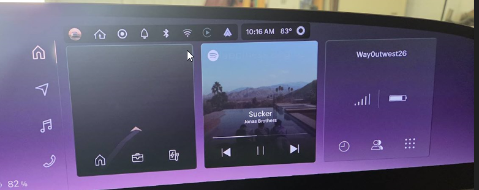
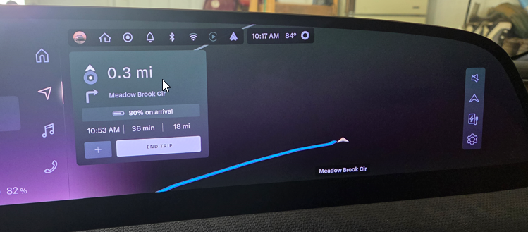
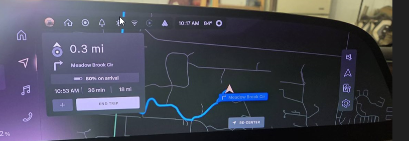
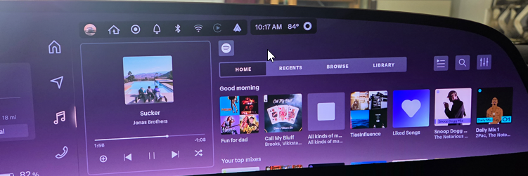
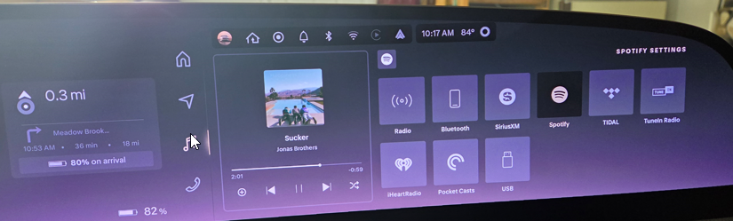
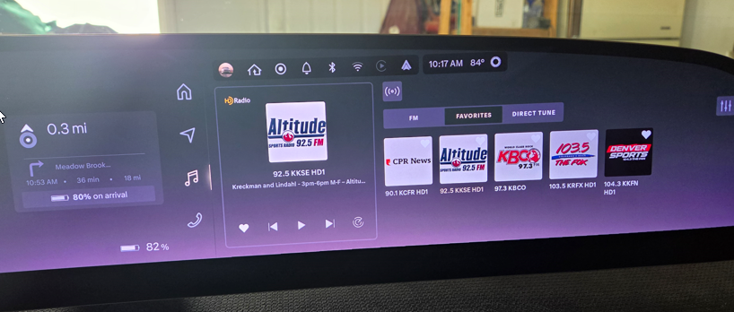
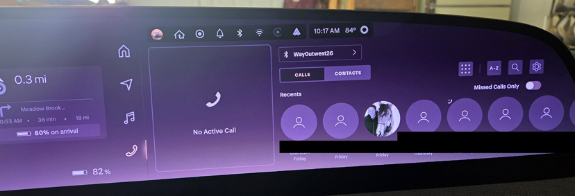

I'm doing a series of posts on the Lucid Gravity tech, and this one covers the right side of the Cockpit Panel. This is the main interface for driver outside of speed, and it's the one where my eyes go often. It's interesting, and can be busy, but I like the idea of the panel.

There are multiple screens in the 2026 Lucid Gravity. The Cockpit Panel is the one that is up high, in front of the driver. This post looks at the section to the right of the driver (in the US). It's got a lot of stuff, but it's also surprisingly helpful after coming from the minimalist Tesla interface. Video of this below:

<iframe width="560" height="315" src="https://www.youtube.com/embed/huoPnMkF_5E?si=gH9y5GJZPL0lDp5j" title="YouTube video player" frameborder="0" allow="accelerometer; autoplay; clipboard-write; encrypted-media; gyroscope; picture-in-picture; web-share" referrerpolicy="strict-origin-when-cross-origin" allowfullscreen></iframe>

This section has really 4 settings, which are on the left side of the screen. These are:
- Home
- Navigation
- Media
- Phone

I can move between these by swiping my finger on the right D-pad of the steering wheel. This is a nice feature, and I can do it without looking at the screen. I can also tap the screen, but I like the D-pad better.

Home has a 3 panel display: a nav image, the current media image, and my phone when connected with the signal strength. Pressing any of these swithes to that view. I'll look at each view below. I don't find myself using the Home view much, as I prefer to have details, though I wish I had a way to remove all this info at times, blanking the screen.

This section is also where Android Auto appears, but I'll show that separately.

The home screen looks like this image. Nav, media, phone listed. Right right side are the section icons.

It also has the across the top:
- profile
- Homelink
- Drivecam (Halo)
- Notifications
- Bluetooth
- Wi-fi
- something (I'll track this down)
- Android Auto
- Clock
- Temp

I wish I could adjust the fonts on the clock/temp, or dup these in the center, but maybe in the future. I'll send a suggestion there. 

### Navigation
I really appreciate having navigation up high, especially when driving. This is a wide view and it let's me know where I am on the map. When I'm in this view, it also has the next two directions visible. Sometimes other nav does this, but since I sometimes have a turn and then an immediate turn, I like seeing the next two with a good font. Even with my poor eyes (2.0 diopter reader guy), I can see what's next and the distance to the change. You can see below I have selected a destination, so I see the next turn and stats. The stats remain. If I start driving, it will show the 2nd turn.

I can change the view to show the map as N oriented or car oriented. I prefer the car oriented, as it shows me where I'm going. I can also zoom in and out, which is nice. I can also change the map style to show traffic, which is helpful. Below is the car oriented view, zoomed out a bit.

### Media
This view gives me the currently playing media, and a few other options. When radio is on, I can see the stations or my favorites. I tend to listen to Spotify, so this is often my default view. I have the song playing on the left, and then other stuff to the right. 

The button in the upper left, above the "home" is the media source. If I click that, I see all the sources the car can handle. I wish I could turn some of these off, as I don't have subscriptions to some of these.

If I switch to the radio, then I see the various stations. It starts on the "FM" selection, but I usually end up clicking "Favorites". I wish this defaulted or remembered where I last was, as I never want to see all the stations.

This is really nice, but the UX could be improved.

### Phone
The last section is the phone section. This be default shows my recent calls. I could scroll right with my thumb and re-call someone easily. There are also buttons for contacts and then the dialer and other phone items.

Haven't used this yet, but I'm sure I will at some point.

## Summary
This is a nice view, and I like that I can pick the things that matter to me, but the lower Pilot Panel is separate and can show other things.

To me, this is an improvement over what Tesla did. Nothing wrong with minimal stuff in the Tesla, but at times it's nice to have more info, or not have the driver distracted from what the passenger does, and I like having this separate view.

I see room for more improvement, and certainly I wish I had the chance to turn this off at times, especially at night.