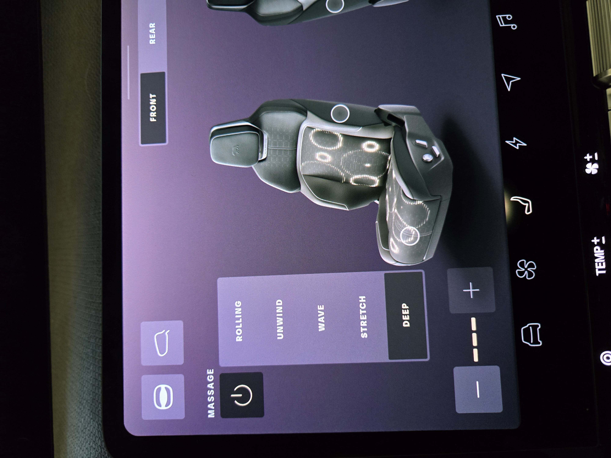

One of the things we were excited about in the Gravity was the cooled seats. We've driven a few cars with them, but never owned one. With Denver being well over 90F/30C this year, we were looking forward to another way to keep cool.

The massage caught our eye, however. The sales guy demo'd this and it was interesting. I've got a video below that shows some of this, and I'm surprised how much I've enjoyed and used this the first week. We'll see how it goes over time.

<iframe width="560" height="315" src="https://www.youtube.com/embed/ovdo7ls1ucw?si=IKrJnsfKsKuhnqfA" title="YouTube video player" frameborder="0" allow="accelerometer; autoplay; clipboard-write; encrypted-media; gyroscope; picture-in-picture; web-share" referrerpolicy="strict-origin-when-cross-origin" allowfullscreen></iframe>

Heating is standard, with 3 levels as most modern cars. The driver and passenger get this, as well as both of the left and right rear seats. The rear middle seat does not have this, unlike the Tesla Model Y we owned.

Cooling is only in the front two seats, and also has 3 levels. I've not used this extensively, but it seems to work well. On the days closer to 90F, level 2 works well. On a colder day in SF, maybe 75F, it was too cold. The high level is what I've used on the days that are near 100F.

Massage is interesting. It's the main setup, and there are multiple settings. You can see in the video, and there is a touch drop down on the screen with each level. If you pick that, massage starts with whatever was last used in your profile. The items are:
- Deep
- Rolling
- Unwind
- Stretch
- Wave

More in the video, but each of these goes from my mid-back to lower-back to glutes (two areas). It's better than what I remember in the Cadillac, though it's not like a nice massage chair. It's surprisingly nice at times when I'm driving and keeps my rear from falling asleep. I can see this as a long-drive feature.

At the same time, when I'm commutting around town, it's a little annoying, and I find myself turning it off.

I didn't show in the video, but if you look at this image, there are two circles on the seat image. One is the lower front part of the bottom, and the other is on the side. These are adjustments. The lower one, which my wife loves, is to extend or retract thigh support. She has long legs, so making the seat a little longer makes it more comfortable. My BMW X5 had this, though it was manual and she kept her side extended.

The other is the side bolsters, which you can tighten or loosen against your kidneys. I tried tightening this a bit but didn't like it. I'll experiment with it, but it's nice that you have control here.

There are also the standard 3 side controls. One to move the seat forward/back and raise it. The second is the tilt control. There is a third, which is a round control for the lumbar support. I haven't quite decided how I like things, but as I adjust the drivers seat, it's nice that there is a "save" and "restore" button that pops up for me to save settings.

When I do this as a passenger, there is a popup that has a 1/2/3 on it to save the settings. I don't know if those are set to the profile, but we'll experiment. My wife and both picked "3" first, so I switched to 1 and saved my settings there.

These are nice seats, great leather feel, and so far I've been comfortable. We've been in the car at most for about 75 minutes, but they've been fun minutes. We'll see over time.
